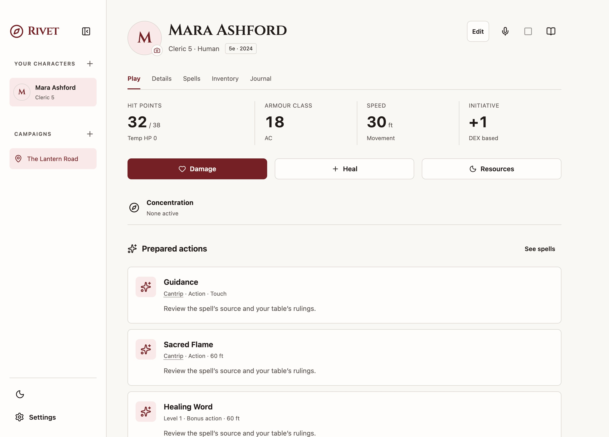

# Rivet

**Your character sheet, ready for the table.**

Rivet is a free, open-source D&D desktop companion for macOS. Keep character sheets, a linked campaign notebook, and edition-specific SRD references on your Mac. An optional ChatGPT guide, Oracle, can explain rules and help with character changes.

[Website](https://nk2580.github.io/rivet/) · [Build for macOS](docs/building-macos.md) · [Rules coverage](docs/rules-coverage.md) · [Contributing](CONTRIBUTING.md) · [Issues](https://github.com/nk2580/rivet/issues)



## Get Rivet

**Early release: build from source.** There is no prebuilt installer, Apple Developer ID signature, or notarization yet. The macOS packaging script applies and verifies a local ad-hoc signature automatically. You do not need a paid Apple Developer membership.

Requirements: macOS, Node.js **22.17+**, **pnpm 10.34.7**, and **Xcode Command Line Tools**. Apple Silicon is the locally verified build target; Intel macOS builds need testing. See the [full macOS guide](docs/building-macos.md) for prerequisites and troubleshooting.

```sh
git clone https://github.com/nk2580/rivet.git
cd rivet
pnpm install --frozen-lockfile
pnpm package:desktop
open "release/Rivet-darwin-$(node -p process.arch)/Rivet.app"
```

The first build downloads checksum-pinned native speech dependencies. The app bundles its runtime, interface, and rules database; after building, opening it requires no terminal, development server, Node.js, or Docker.

## What it does

- **Character sheets** for 5e 2014, 5e 2024, and 3.5e, with HP, spells, slots, equipment, currencies, resources, and undoable changes.
- **A campaign notebook** linking sessions, people, places, quests, facts, and rulings. Choose which notes may be included for the guide.
- **Offline SRD search** across bundled rules, spells, equipment, and character options, with edition filters and source references.
- **Local storage** in SQLite, multiple windows, workspace JSON import/export, and recoverable record archiving.
- **Appearance** with six main colours and light/dark modes. The running Dock icon and favicon follow your saved choice, with a little space around the compass mark.
- **Optional Oracle chats** through your eligible ChatGPT account. Local MCP tools search rules and access character context. Routine requested sheet changes save with Undo receipts; other changes require review.
- **Optional session capture** with on-device English speech recognition after a model download. Audio is discarded. ChatGPT can turn transcript text and corrections into editable recaps.

Rivet is a work in progress. Character creation and advancement are manual, and rules automation is incomplete. It has no dice roller. [Read the coverage notes](docs/rules-coverage.md) and review character values with your DM.

## Data and optional online features

Rivet opens without a Rivet account. Sheets, notes, and local rules search work offline. On macOS, the workspace database is normally `~/Library/Application Support/Rivet/workspace.sqlite`. Keep JSON backups using workspace settings before changing or moving your installation.

Oracle and generated recaps require internet, ChatGPT authorization, and eligible plan access, subject to OpenAI's availability and usage limits. Rivet does not provide free model inference. Request context, explicitly shared notes, and transcript text for recaps are sent to OpenAI when those features are used. The model does not run locally. Audio and portrait images are not sent as automatic guide context.

ChatGPT tokens stay in the Electron main process. The macOS connection is protected by a Secure Enclave-backed helper and an explicit Touch ID or Mac-password unlock. Moving to another Mac requires a new ChatGPT connection. Macs without an available Secure Enclave may be unable to use Oracle; local sheets and rules remain available.

## Development

```sh
pnpm install --frozen-lockfile
RIVET_DATA_DIR="$PWD/.local/dev-workspace" pnpm dev
```

`pnpm dev` builds and opens Electron. After renderer edits, rebuild and relaunch. Use an isolated workspace for development.

```sh
pnpm typecheck
pnpm test
pnpm test:legacy
pnpm build:desktop
```

See [architecture](docs/architecture.md), [contribution guidance](CONTRIBUTING.md), and the [macOS build guide](docs/building-macos.md). The current app uses Electron, React, TypeScript, shadcn-based components, and SQLite. The Go/Firebase browser prototype is historical and is not required to build or run the desktop app.

### Project website

The GitHub Pages site is in `website/`. It uses static HTML, CSS, local assets, and a small command-copy script. No analytics, external fonts, or website backend are included.

```sh
pnpm dev:site
pnpm build:site
```

The preview runs at `http://127.0.0.1:4174/rivet/`. `build:site` copies the deployable site to `dist-site/`. The Pages workflow deploys this directory when website changes reach `main`.

## License and acknowledgements

Application code is [MIT licensed](LICENSE), © 2026 Nik Kyriakidis. Bundled content and dependencies retain their own licenses:

- SRD 5.1 and SRD 5.2.1: Creative Commons Attribution 4.0, Wizards of the Coast LLC.
- 3.5e SRD Open Game Content: Open Game License 1.0a; the original notice and Section 15 are bundled in `public/rules/OGL-1.0a.txt`.
- Cinzel: SIL Open Font License 1.1. Vosk: Apache 2.0. Other notices are in [THIRD_PARTY_NOTICES.md](THIRD_PARTY_NOTICES.md).

Rivet is independent community software, not affiliated with or endorsed by Wizards of the Coast or OpenAI. Dungeons & Dragons and ChatGPT are trademarks of their respective owners.
